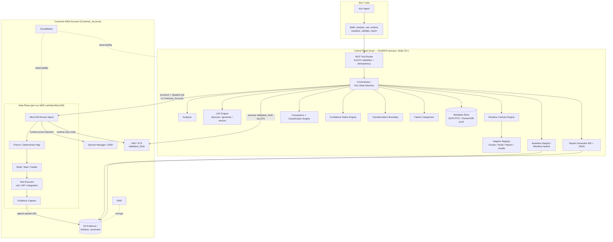
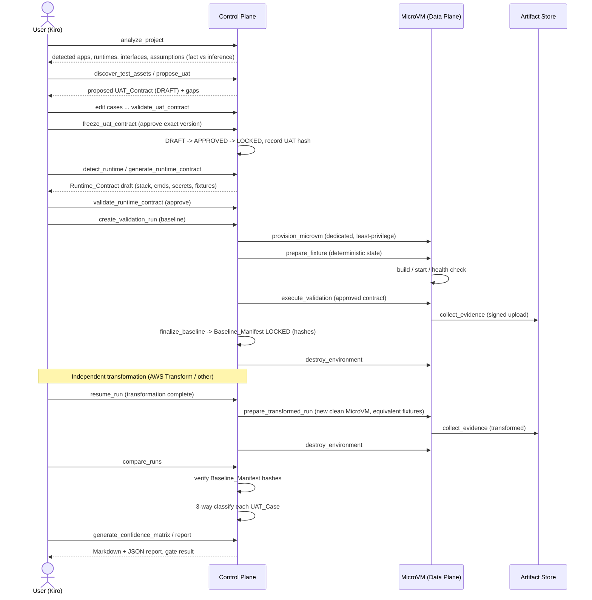
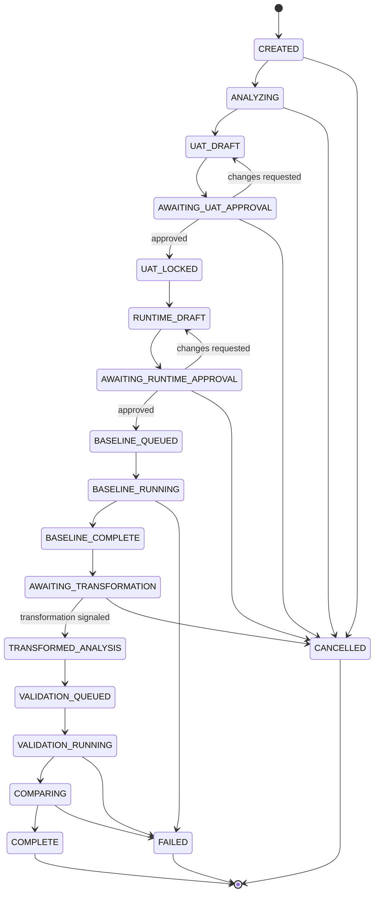

# Design Document

## Overview

The AI Transformation Validator is a Kiro Power that produces credible, auditable evidence that an AI-modernized application preserves required behavior. It is delivered as an Agent Plugin (plugin.json, mcp.json, skills) backed by a TypeScript MCP server running on Node.js 22+. The server exposes a set of small, discrete, idempotent MCP tools rather than one opaque workflow operation.

The core value is a **three-way differential comparison** between (1) the *expected* behavior defined by a user-approved UAT contract, (2) the *baseline* observations captured by running the legacy application, and (3) the *transformed* observations captured by replaying the identical contract against the modernized application. This three-way comparison is what prevents "same as legacy" from being silently blessed as "correct": a test that failed on legacy and still fails on transformed is classified as an `EXISTING_DEFECT`, not a passing baseline.

The system enforces a strict chain of trust and integrity:

1. **Approval gates** — neither the UAT contract nor the runtime contract becomes authoritative until the user explicitly approves the exact version.
2. **Immutable baseline** — once baseline evidence is locked, it is frozen with a content-hash manifest that is verified before any comparison.
3. **Disposable isolation** — all untrusted customer code runs inside a dedicated, per-run AWS Lambda MicroVM with least-privilege credentials and restricted egress, torn down after every run.
4. **Plane separation** — a Control Plane owns orchestration, state, approvals, comparison and reporting and runs locally inside the Kiro/MCP process on the developer's machine; a Data Plane (the MicroVM) owns source staging, build, execution and raw evidence capture and runs, together with all other AWS resources, only inside the customer's AWS account reached via an assumed role. They use separate identities.
5. **Customer-account execution** — the product runs no AWS infrastructure of its own. All AWS resources (the Lambda MicroVM sandbox, S3 evidence/artifact storage, Secrets Manager/SSM, KMS, CloudWatch) are provisioned and run exclusively in the `Customer_Account`, reached by the locally-run Control Plane assuming the customer-provided `Validation_Role` via AWS STS and using only the resulting temporary credentials. Customer source code, evidence, and secrets never leave the `Customer_Account`.

### Design Principles

- **Evidence, not inference** — analysis findings are labeled fact vs. inference; existing failures are evidence, never auto-promoted into expected-outcome rules.
- **Transparent confidence** — the confidence result is a weighted matrix with visible raw counts and formulas, never a black-box AI score.
- **Deterministic comparison** — equivalent fixture state, fixed seeds, and clock control make baseline and transformed runs comparable; flaky cases are flagged `INCONCLUSIVE` rather than passed.
- **Extensible boundaries** — runtime stacks, transformation providers, comparison strategies, and dependency policies are all pluggable to admit SHOULD/Later scope without reworking the core.

### MVP Scope Boundary

This design targets the MVP MUST capabilities: single-project analysis, UAT discovery/generation/approval, Runtime Adapters for Docker/Node.js/Java Maven/Java Gradle, MicroVM provisioning and teardown, runtime secret injection, deterministic seeding, unit/API/integration execution, baseline manifest, same-UAT transformed replay, exact/schema/ignore/tolerance comparison, core classification, confidence matrix, Markdown/JSON reporting, and hash-based baseline integrity. SHOULD/Later items (Python/.NET adapters, record/replay, semantic comparison, RBAC, CI/CD gates, multi-service apps) are called out as extension points.

## Architecture

### High-Level Component Architecture

The Validator is split along a Control Plane / Data Plane boundary (Requirement 17). The Kiro Power and MCP server live in the Control Plane; untrusted customer code executes only in the Data Plane MicroVM.



The Control Plane runs locally in the Kiro/MCP process on the developer's machine; it operates no vendor AWS infrastructure. Every AWS box shown above — the Data Plane MicroVM, S3, Secrets Manager/SSM, IAM/STS, KMS, and CloudWatch — lives inside the `Customer_Account` and is accessed by the local Control Plane assuming the customer-provided `Validation_Role` via STS (Requirements 17.5–17.8).

Only normalized evidence required to compute and report results crosses the boundary from Data Plane to Control Plane (Requirement 17.3). The local Control Plane never hands control-plane credentials to the MicroVM (Requirements 7.4, 8.2); it reaches the `Customer_Account` solely through the assumed `Validation_Role` temporary credentials (Requirement 17.7).

### End-to-End Workflow Sequence



### MCP Tool Surface

The MCP server is the local Control Plane: it runs inside the Kiro/MCP process on the developer's machine and owns no vendor-hosted infrastructure. Any tool that touches AWS does so by assuming the customer-provided `Validation_Role` via STS and operating within the `Customer_Account` (Requirements 17.5–17.7). Every tool validates its input and output against a Zod schema (Requirement 1.3) and each workflow capability is a discrete operation (Requirement 1.4). All state-changing tools accept an `idempotencyKey` and return the original stored result when replayed (Requirement 1.5).

| Tool | State-changing | Purpose | Requirements |
|---|---|---|---|
| `analyze_project` | no | Inspect repo; emit detected apps, runtimes, interfaces, assumptions | 2 |
| `discover_test_assets` | no | Find existing UAT/docs/tests/API specs | 3.1 |
| `propose_uat` | yes | Generate proposed UAT_Contract (DRAFT) + gaps | 3.2–3.6 |
| `validate_uat_contract` | no | Validate a UAT_Contract structurally | 1.3, 4.2 |
| `freeze_uat_contract` | yes | Approve + lock exact UAT version; record hash | 4.3–4.6 |
| `detect_runtime` | no | Run adapter detection with confidence + evidence | 5.1–5.4 |
| `generate_runtime_contract` | yes | Produce Runtime_Contract draft | 6.1, 6.2 |
| `validate_runtime_contract` | yes | Approve a Runtime_Contract version | 6.3, 6.4 |
| `create_validation_run` | yes | Create a tracked, resumable Validation_Run | 16 |
| `provision_microvm` | yes | Provision dedicated isolated MicroVM in the Customer_Account via the assumed Validation_Role | 7, 17.6, 17.7 |
| `prepare_fixture` | yes | Restore deterministic fixture state; inject secrets at runtime | 8 |
| `execute_validation` | yes | Build/start/health, run approved contract | 9, 10 |
| `collect_evidence` | yes | Capture + upload normalized evidence | 10.2, 10.3 |
| `finalize_baseline` | yes | Produce + lock Baseline_Manifest | 11 |
| `prepare_transformed_run` | yes | New clean MicroVM, equivalent fixtures, replay | 13 |
| `compare_runs` | yes | Verify hashes, 3-way compare + classify | 11.4, 14 |
| `generate_confidence_matrix` | yes | Weighted matrix + gate | 15 |
| `get_run_status` | no | Return current persisted run state | 16.3 |
| `resume_run` | yes | Resume an interrupted run from persisted state | 16 |
| `destroy_environment` | yes | Terminate MicroVM, release resources, record cleanup | 7.8, 7.9 |

### Kiro Power Package Structure

```text
transformation-validator/
├── plugin.json
├── mcp.json
└── skills/
    ├── analyze/SKILL.md
    ├── uat/SKILL.md
    ├── runtime/SKILL.md
    ├── baseline/SKILL.md
    ├── validate/SKILL.md
    └── report/SKILL.md
```

This satisfies Requirement 1.1 (plugin.json, mcp.json, and the six named skills).

## Components and Interfaces

### Analyzer (Requirement 2)

Inspects available build manifests, container definitions, CI/CD config, entrypoints, test config, API definitions, routes, environment templates, DB schema, documentation, and existing test assets. It produces detected applications, candidate runtimes, required dependencies, candidate commands, externally reachable interfaces, existing test assets, assumptions, and unsupported components. Every finding is labeled `fact` or `inference` (2.3); unclassifiable components are reported as `unsupported` rather than assigned an inferred runtime (2.4).

```ts
interface AnalysisFinding {
  kind: "application" | "runtime" | "dependency" | "command" | "interface" | "testAsset" | "assumption" | "unsupported";
  label: "fact" | "inference";
  detail: string;
  sourceRefs: string[];
}

interface ProjectAnalysis {
  projectId: string;
  detectedApplications: DetectedApplication[];
  candidateRuntimes: CandidateRuntime[];
  requiredDependencies: string[];
  candidateCommands: CandidateCommand[];
  interfaces: ReachableInterface[];
  existingTestAssets: TestAsset[];
  assumptions: AnalysisFinding[];
  unsupportedComponents: AnalysisFinding[];
  findings: AnalysisFinding[]; // every item carries fact|inference
}
```

### UAT Engine (Requirements 3, 4)

Three responsibilities: **discovery** of existing assets, **generation** of inferred cases when none exist, and **versioning/approval**.

- Discovery (`discover_test_assets`) returns each identified asset with `source` ∈ {`existing`, `user`} (3.1).
- Generation (`propose_uat`) derives cases from code/tests/API/routes/business rules/DB constraints/config/sample payloads, classifying each as `inferred` (3.2). When a data format is parsed/serialized, it proposes a parse case, a pretty-print case, and a round-trip case whose expected outcome asserts `parse(print(parse(x))) == parse(x)` under the round-trip comparison policy (3.5). If nothing can be derived it returns an empty proposed contract and reports uncovered areas rather than a placeholder (3.6).
- Versioning follows `DRAFT → APPROVED → LOCKED`, with a superseding version retaining the prior locked one (4.1–4.6).

```ts
type UatSource = "existing" | "user" | "inferred";
type Criticality = "critical" | "high" | "medium" | "low";
type UatType = "api" | "integration" | "unit" | "workflow";
type UatStatus = "DRAFT" | "APPROVED" | "LOCKED" | "SUPERSEDED";

interface UatCase {
  id: string;
  title: string;
  source: UatSource;
  sourceRefs: string[];
  confidence: number;            // 0.0–1.0 inclusive
  criticality: Criticality;
  type: UatType;
  preconditions: string[];
  steps: UatStep[];
  expected: ExpectedOutcome[];
  comparisonPolicy: ComparisonPolicy;
  evidenceRequired: EvidenceRequirement[];
}

interface UatContract {
  id: string;
  version: number;
  status: UatStatus;
  cases: UatCase[];
  assumptions: string[];
  uncoveredAreas: string[];
  contentHash?: string;          // set when LOCKED
  supersedesVersion?: number;
  approval?: ApprovalRecord;
}
```

### Runtime Adapter Pattern (Requirements 5, 6)

The orchestrator contains no stack-specific build logic. Each adapter detects a stack (returning confidence + evidence), discovers build/run/health/test/dependency specs, and generates/validates a Runtime_Contract.

```ts
interface RuntimeAdapter {
  id: string;                    // "docker" | "node" | "maven" | "gradle"
  detect(ctx: ProjectContext): Promise<DetectionResult>;
  discoverBuild(ctx: ProjectContext): Promise<BuildSpec>;
  discoverRun(ctx: ProjectContext): Promise<RunSpec>;
  discoverHealth(ctx: ProjectContext): Promise<HealthSpec | null>;
  discoverTests(ctx: ProjectContext): Promise<TestSpec[]>;
  discoverDependencies(ctx: ProjectContext): Promise<DependencySpec[]>;
  generateRuntimeContract(ctx: ProjectContext): Promise<RuntimeContractDraft>;
  validateRuntimeContract(c: RuntimeContract): Promise<ValidationResult>;
}

interface DetectionResult {
  adapterId: string;
  confidence: number;            // 0.0–1.0
  evidence: AnalysisFinding[];
  applicable: boolean;
}
```

MVP adapters: generic **Docker**, **Node.js**, **Java Maven**, **Java Gradle** (5.1). Multiple adapters may contribute to one contract (5.4); the generic Docker adapter is the preferred fallback where a valid Dockerfile exists (5.3); user override is always possible (5.5). Python/.NET are registered later as additional `RuntimeAdapter` implementations — no core change (extension point).

The `AdapterRegistry` ranks applicable adapters by detection confidence, surfaces evidence to the user, and lets the user pin a selection.

### Runtime Contract Engine (Requirement 6)

`generate_runtime_contract` composes adapter output into a draft containing build commands, runtime strategy+version, start command, ports, health check, required env vars, secret references, dependent services, fixture reset/seed commands, readiness conditions, and test commands (6.1). The draft display surfaces detected stack, commands, ports, dependent services, env vars, secret references, fixture strategy, network dependencies, destructive operations, and unsupported assumptions (6.2). Contracts are excluded from execution until approved (6.3) and versioned independently for legacy and transformed (6.4).

```ts
interface RuntimeContract {
  version: number;
  target: "legacy" | "transformed";
  application: { name: string };
  runtime: { strategy: string; adapter: string; version: string };
  build: { commands: string[] };
  start: { command: string; workingDirectory: string; ports: number[] };
  health: HealthSpec;
  environment: { required: string[]; secrets: SecretRef[] };
  services: DependentService[];
  fixtures: { resetCommand?: string; seedCommand?: string };
  readiness: ReadinessCondition;
  tests: TestSpec[];
  dependencies: DependencyPolicy[];
  approval?: ApprovalRecord;
}
```

### MicroVM Runner / Provisioner (Requirement 7)

Provisions a **dedicated** MicroVM per Validation_Run inside the `Customer_Account` via the assumed `Validation_Role` (Requirements 17.6, 17.7), used by no other run (7.2), with no shared mutable filesystem/runtime state (7.3). Each MicroVM gets a least-privilege IAM execution role and runtime-only temporary credentials, never control-plane credentials (7.4). It applies a configurable max run duration, CPU/memory/disk limits where supported, and a deny-by-default egress policy with only approved destinations (7.5). On max-duration breach it terminates the MicroVM and records a timeout failure (7.6). Reusable images/snapshots exclude control-plane credentials and tenant secrets (7.7). On completion/failure it terminates, releases resources, and records a cleanup result (7.8); if release fails it records a cleanup failure and flags the MicroVM so it is not reused (7.9).

```ts
interface MicroVmSpec {
  runId: string;
  target: "baseline" | "transformed";
  executionRoleArn: string;      // least-privilege, run-scoped
  maxDurationSeconds: number;
  resourceLimits: { cpu?: number; memoryMb?: number; diskMb?: number };
  egressPolicy: { mode: "deny-all"; allow: string[] };
  artifactUploadUrl: string;     // signed, short-lived
}

interface MicroVmHandle {
  microVmId: string;
  runId: string;
  status: "provisioning" | "ready" | "running" | "terminated" | "cleanup_failed";
}
```

### Fixture / Determinism Manager (Requirement 8)

Restores the deterministic fixture state defined by the Runtime_Contract before start (8.1). Injects secrets only at runtime via secret references (8.2); excludes secret values from Git/logs/snapshots/UAT artifacts/reports (8.3); redacts values matching known secret formats when capturing logs (8.4); and prevents a transformed run from reusing mutable state produced by the baseline run (8.5). Supports fixed random seed and clock override for determinism (flakiness handling).

### Build / Start / Health (Requirement 9)

After fixtures restore, runs build commands then the start command (9.1), waits for the readiness condition before tests (9.2), and classifies a readiness timeout as a health/readiness failure without executing the contract (9.3).

### Evidence Collector (Requirement 10)

Executes unit/API/integration test commands from the approved contract (10.1); captures normalized test results, request/response pairs, and application logs (10.2 capture); and streams/uploads large evidence to artifact storage instead of returning it in MCP payloads (10.3 large-evidence).

```ts
type Observation = "pass" | "fail" | "blocked" | "not_executed";

interface NormalizedCaseResult {
  caseId: string;
  observation: Observation;
  assertions: AssertionResult[];
  evidenceRefs: EvidenceArtifactRef[]; // pointers to S3, never inline blobs
}

interface EvidenceArtifactRef {
  artifactId: string;
  kind: "testResult" | "httpPair" | "log" | "custom";
  storageUri: string;            // s3://...
  sha256: string;
}
```

### Baseline Integrity (Requirement 11)

On baseline completion produces a `Baseline_Manifest` with baseline id, UAT version, source git commit, UAT hash, runtime hash, fixture hash, evidence manifest hash, approver, approval time, and status `LOCKED` (11.1). Baseline evidence is immutable once LOCKED (11.2). It never converts a pre-existing legacy failure into an expected-outcome rule (11.3). Before a transformed comparison it verifies manifest hashes (11.4); a verification failure stops the comparison and reports the integrity failure (11.5).

```ts
interface BaselineManifest {
  baselineId: string;
  uatVersion: number;
  sourceGitCommit: string;
  uatHash: string;               // sha256
  runtimeHash: string;
  fixtureHash: string;
  evidenceManifestHash: string;
  approvedBy: string;
  approvedAt: string;            // ISO-8601
  status: "LOCKED";
}
```

### Transformation Boundary (Requirement 12)

When baseline evidence is locked, the run pauses and awaits an independent transformation (12.1). AWS Transform for Kiro is treated as one independent `TransformationProvider`; the Validator does not own its internals (12.2). When the user signals completion, the run resumes and the transformed runtime is analyzed (12.3). A generic provider interface admits future providers/manual modernization (12.4, extension point).

```ts
interface TransformationProvider {
  id: string;                    // "aws-transform" | "manual" | ...
  describe(): ProviderInfo;
  awaitCompletionSignal(runId: string): Promise<TransformationSignal>;
}
```

### Comparison + Classification Engine (Requirement 14)

For each UAT_Case it evaluates the expected outcome, the baseline observation, and the transformed observation, each resolving to exactly one of `pass | fail | blocked | not_executed` (14.1), and assigns exactly one of eight classifications (14.2). The deterministic truth table:

| Expected | Baseline | Transformed | Classification | Clause |
|---|---|---|---|---|
| pass | pass | pass | `UNCHANGED_PASS` | 14.6 |
| pass | pass | fail | `REGRESSION` | 14.3 |
| pass | fail | fail | `EXISTING_DEFECT` | 14.4 |
| pass | fail | pass | `IMPROVEMENT` | 14.5 |
| any | blocked | * | `BLOCKED` | 14.7 |
| any | * | blocked | `BLOCKED` | 14.7 |
| any (no block) | not_executed | * | `NOT_EXECUTED` | 14.7 |
| any (no block) | * | not_executed | `NOT_EXECUTED` | 14.7 |
| superseded-changed | baseline | transformed (= new expected, ≠ baseline) | `INTENTIONAL_CHANGE` | 14.8 |

`BLOCKED` takes precedence over `NOT_EXECUTED` when both apply (14.7). Comparison applies per-case strategies — exact, schema, subset, ignored fields, regex, numeric tolerance, date/time tolerance, unordered collection, custom predicate, semantic — defaulting unspecified fields to `exact` (14.9). If a case yields differing pass/fail observations across ≥3 consecutive executions of the same approved UAT version in equivalent deterministic state, it is `INCONCLUSIVE` and must not receive `UNCHANGED_PASS`/`REGRESSION`/`EXISTING_DEFECT`/`IMPROVEMENT` (14.10).

```ts
type Classification =
  | "UNCHANGED_PASS" | "REGRESSION" | "EXISTING_DEFECT" | "IMPROVEMENT"
  | "BLOCKED" | "NOT_EXECUTED" | "INTENTIONAL_CHANGE" | "INCONCLUSIVE";

interface DifferentialCaseResult {
  caseId: string;
  expected: Observation;
  baseline: Observation;
  transformed: Observation;
  classification: Classification;
  strategyApplied: ComparisonStrategy[];
  diff: FieldDiff[];
}

type ComparisonStrategy =
  | "exact" | "schema" | "subset" | "ignoredFields" | "regex"
  | "numericTolerance" | "dateTimeTolerance" | "unordered"
  | "customPredicate" | "semantic";
```

Semantic comparison is a registered strategy used only for explicitly approved cases (extension point for Later scope).

### Confidence Matrix Engine (Requirement 15)

Produces exactly six named dimensions — Critical Workflows, Approved UAT Execution, API/Contract Compatibility, Integration Behavior, Environment Parity/Determinism, Evidence Completeness — with default weights 35/20/15/15/10/5% (15.1). If configured weights do not sum to 100% (±0.1%) it rejects the configuration with an error naming the invalid weights and produces no matrix (15.2). For each dimension it shows raw weighted passed-assertion count, raw weighted executed-assertion count, and `dimensionScore = weightedPassed / weightedExecuted` (15.3). `overallConfidence = Σ(dimensionScore × weight)` with per-dimension values displayed (15.4). A critical `REGRESSION` forces overall gate `FAIL` regardless of score (15.5); a critical `NOT_EXECUTED` caps the gate at `INCONCLUSIVE` (15.6). Only `REGRESSION` cases count toward the new-regression total (15.7). Intentionally unsupported areas are excluded from the denominator only where explicitly accepted, and every excluded area is listed (15.8).

```ts
interface ConfidenceDimension {
  name:
    | "Critical Workflows" | "Approved UAT Execution" | "API/Contract Compatibility"
    | "Integration Behavior" | "Environment Parity/Determinism" | "Evidence Completeness";
  weight: number;                // fraction summing to 1.0 (±0.001)
  weightedPassed: number;
  weightedExecuted: number;
  dimensionScore: number;        // weightedPassed / weightedExecuted
}

interface ConfidenceMatrix {
  dimensions: ConfidenceDimension[];   // exactly 6
  overallConfidence: number;
  newRegressionCount: number;
  excludedAreas: string[];
  gate: "PASS" | "INCONCLUSIVE" | "FAIL";
}
```

### Report Generator (Requirement 15.9)

Produces one Markdown and one JSON report that each contain identical per-UAT_Case classifications, evidence references per case, the coverage breakdown (approved-UAT execution, critical-workflow, API contract, integration, blocked/unsupported), the Confidence_Matrix, the overallConfidence value, and the overall gate result.

### Run State Machine (Requirement 16)

Persists each run through its lifecycle states, persists every transition, returns current state on request, and records an audit trail of approvals and executions. Detailed states appear under Data Models.

### Failure Categorizer (Requirement 18)

Classifies any run failure into one of: configuration, unsupported stack, build, dependency, fixture, health/readiness, test failure, runner failure, infrastructure, timeout, permission, artifact/evidence, comparison, cleanup (18.1). It never reports an infrastructure or test-runner failure as an application regression (18.2), and allows retries only for retry-safe infrastructure operations (18.3).

## Data Models

### Persistence Entities (Requirement 16, source §24)

| Entity | Key fields | Notes |
|---|---|---|
| `Project` | projectId, repoRef | Root of analysis |
| `UATContract` | id, projectId | Logical contract |
| `UATVersion` | contractId, version, status, contentHash | DRAFT→APPROVED→LOCKED→SUPERSEDED |
| `RuntimeContract` | id, projectId | Logical runtime contract |
| `RuntimeVersion` | contractId, version, target, approval | legacy vs transformed |
| `Baseline` | baselineId, manifest | Immutable once LOCKED |
| `ValidationRun` | runId, state, uatVersion, baselineId | Resumable |
| `ExecutionJob` | jobId, runId, microVmId, target | Build/test job on a MicroVM |
| `TestCaseResult` | jobId, caseId, observation, evidenceRefs | Normalized result |
| `EvidenceArtifact` | artifactId, storageUri, sha256, kind | Pointer to S3 object |
| `ComparisonResult` | runId, caseId, classification, diff | Per-case 3-way result |
| `Approval` | approvalId, subjectType, version, approver, approvedAt | UAT + runtime approvals |
| `DependencyPolicy` | name, strategy | real/sandbox/mock/record-replay/stub/ignored/manual |
| `ConfidencePolicy` | dimensions, weights | Weight config (validated to 100%) |

**Storage tiers.** The POC uses local repository JSON plus S3/artifact manifests; production uses DynamoDB (or a relational store) for durable workflow metadata. Large evidence always lives in S3 with object versioning/retention; Git retains only manifests, hashes, human-readable summaries, and pointers.

### Repository Layout (`.validator/`)

```text
.validator/
├── config/validator.yaml
├── uat/
│   ├── draft.json
│   └── baseline-v1.json
├── runtime/
│   ├── legacy-v1.yaml
│   └── transformed-v1.yaml
├── fixtures/
│   ├── manifest.yaml
│   ├── seed/
│   └── mocks/
├── baselines/
│   └── baseline-v1.manifest.json
├── evidence/              # pointers/summaries; blobs in S3
│   ├── legacy/
│   └── transformed/
└── reports/
    ├── comparison.json
    └── report.md
```

Baseline integrity is additionally anchored by a git tag such as `validator/baseline/v1`.

### Validation Run State Machine (Requirement 16)



Every transition is persisted (16.2); `get_run_status` returns the current persisted state (16.3); `resume_run` restarts from the persisted state after an interruption (16); and an append-only audit trail records approvals and executions (16.4).

## Correctness Properties

*A property is a characteristic or behavior that should hold true across all valid executions of a system — essentially, a formal statement about what the system should do. Properties serve as the bridge between human-readable specifications and machine-verifiable correctness guarantees.*

The following properties were derived from the acceptance criteria via prework analysis and consolidated to remove redundancy. Each is universally quantified and intended to be implemented as a single property-based test (fast-check) running a minimum of 100 iterations.

### Property 1: Idempotency of state-changing operations

*For any* state-changing MCP operation and *any* idempotency key, invoking the operation a second time with the same key returns the original stored result and produces no additional (duplicate) side effect.

**Validates: Requirements 1.5**

### Property 2: Analysis findings are totally labeled

*For any* project analysis output, every finding carries a label that is exactly one of `fact` or `inference`, and any component that cannot be classified appears under unsupported components with no inferred runtime assigned to it.

**Validates: Requirements 2.3, 2.4**

### Property 3: Generated UAT_Case structural validity

*For any* generated UAT_Case, all required fields are present, `source` ∈ {existing, user, inferred}, `criticality` ∈ {critical, high, medium, low}, `type` ∈ {api, integration, unit, workflow}, and `confidence` lies in the closed interval [0.0, 1.0].

**Validates: Requirements 3.3**

### Property 4: Parse/print round-trip

*For any* valid input `x` of a format with a proposed round-trip case, `parse(print(parse(x)))` equals `parse(x)` under that case's round-trip comparison policy.

**Validates: Requirements 3.5**

### Property 5: Authoritative execution requires a LOCKED contract

*For any* UAT_Contract whose status is not LOCKED, authoritative baseline execution is refused; only a LOCKED version may be executed.

**Validates: Requirements 4.3**

### Property 6: UAT lock immutability and version lineage

*For any* UAT_Contract that is LOCKED, its recorded content hash equals the hash recomputed from its content and never changes; and *for any* superseding version approved after a prior LOCKED version, the prior version remains retrievable with its original hash while the new version records that it supersedes it.

**Validates: Requirements 4.5, 4.6**

### Property 7: Adapter detection reports bounded confidence and evidence

*For any* adapter detection result, the detection confidence lies in [0.0, 1.0] and supporting evidence is present whenever the adapter reports the stack as applicable.

**Validates: Requirements 5.2**

### Property 8: Failed-cleanup MicroVMs are never reused

*For any* MicroVM whose termination or resource release fails, the MicroVM is flagged as a cleanup failure and never appears in the pool of MicroVMs available for reuse by another Validation_Run.

**Validates: Requirements 7.9**

### Property 9: Secret non-leakage across artifacts

*For any* secret value and *any* emitted artifact (git content, log, snapshot, UAT artifact, or report), the secret value does not appear in the emitted artifact after redaction/serialization.

**Validates: Requirements 8.3**

### Property 10: Log redaction of secret-format values

*For any* log line containing one or more values matching a known secret format, every such value is redacted in the captured log output.

**Validates: Requirements 8.4**

### Property 11: Transformed run state independence

*For any* baseline run followed by a transformed run, the transformed run's starting fixture state equals the deterministic seed state and is unaffected by any mutable state the baseline run produced.

**Validates: Requirements 8.5**

### Property 12: Readiness failure suppresses test execution

*For any* run whose readiness condition is not met within the configured timeout, the failure is categorized as health/readiness and zero test-contract cases are executed.

**Validates: Requirements 9.3**

### Property 13: Evidence is returned by reference, not inline

*For any* captured evidence artifact regardless of size, the MCP tool response contains only an evidence reference (pointer to artifact storage) and never the inline evidence blob.

**Validates: Requirements 10.3**

### Property 14: Baseline manifest completeness and integrity gating

*For any* completed baseline, the Baseline_Manifest contains all required fields with status LOCKED; and *for any* manifest, a transformed comparison proceeds if and only if every recorded hash matches the hash recomputed from its content, otherwise the comparison stops and reports an integrity failure.

**Validates: Requirements 11.1, 11.4, 11.5**

### Property 15: Expected outcomes are independent of baseline evidence

*For any* UAT_Case whose baseline observation is a failure, the case's expected outcome is identical before and after baseline capture; a legacy failure is never promoted into an expected-outcome rule.

**Validates: Requirements 11.3**

### Property 16: Transformed replay uses the baseline's locked contract and equivalent fixtures

*For any* baseline-and-transformed run pair, the transformed run executes against the same locked UAT version associated with the baseline and restores fixture state equivalent to the baseline fixture state.

**Validates: Requirements 13.2, 13.3**

### Property 17: Classification totality, exclusivity, and truth-table correctness

*For any* `(expected, baseline, transformed)` observation triple together with its superseded-version and execution-history context, the classifier returns exactly one of the eight classifications, and that classification matches an independent reference implementation of the truth table and precedence rules (BLOCKED over NOT_EXECUTED; INCONCLUSIVE over the four stable classes).

**Validates: Requirements 14.1, 14.2, 14.3, 14.4, 14.5, 14.6, 14.7, 14.8**

### Property 18: Comparison defaults to exact for ungoverned fields

*For any* comparison policy and *any* field for which the policy specifies no strategy, the engine applies the exact comparison strategy to that field.

**Validates: Requirements 14.9**

### Property 19: Flaky cases are INCONCLUSIVE

*For any* UAT_Case whose pass/fail observations differ across at least 3 consecutive executions of the same approved UAT version in equivalent deterministic state, the classification is INCONCLUSIVE and is never UNCHANGED_PASS, REGRESSION, EXISTING_DEFECT, or IMPROVEMENT.

**Validates: Requirements 14.10**

### Property 20: Confidence matrix dimension set and weight validation

*For any* produced Confidence_Matrix the dimension set is exactly the six named dimensions; and *for any* configured weight vector, a matrix is produced if and only if the weights sum to 100% within ±0.1%, otherwise the engine rejects the configuration with an error identifying the invalid weights and produces no matrix.

**Validates: Requirements 15.1, 15.2**

### Property 21: Confidence score determinism and formula

*For any* set of visible weighted assertion counts and *any* valid weight configuration, each `dimensionScore` equals `weightedPassed / weightedExecuted`, `overallConfidence` equals `Σ(dimensionScore × weight)` recomputed independently, and repeated evaluation on identical inputs yields an identical result.

**Validates: Requirements 15.3, 15.4**

### Property 22: Gate overrides and regression accounting

*For any* result set, the presence of a critical-criticality REGRESSION forces the overall gate to FAIL regardless of `overallConfidence`; a critical NOT_EXECUTED (absent a critical REGRESSION) caps the gate at INCONCLUSIVE; and `newRegressionCount` equals exactly the number of cases classified REGRESSION, with every other classification excluded from that total.

**Validates: Requirements 15.5, 15.6, 15.7**

### Property 23: Denominator exclusions are explicit and listed

*For any* report, an unsupported area is excluded from the `overallConfidence` denominator if and only if its exclusion was explicitly accepted, and every excluded area appears in the report's excluded-areas list.

**Validates: Requirements 15.8**

### Property 24: Markdown and JSON reports are consistent

*For any* comparison result, the rendered Markdown and JSON reports contain identical per-UAT_Case classifications and both contain every required section (per-case classifications, evidence references, coverage breakdown, confidence matrix, overallConfidence, and gate result).

**Validates: Requirements 15.9**

### Property 25: Run state persistence round-trip

*For any* sequence of valid state transitions applied to a Validation_Run, the persisted state after each transition equals the applied target state, and reloading the persisted run yields that same current state.

**Validates: Requirements 16.1, 16.2, 16.3**

### Property 26: Failure categorization totality and plane separation

*For any* run failure event the categorizer assigns exactly one of the fourteen defined categories, and *for any* failure categorized as infrastructure or test-runner failure, it is never reported as an application REGRESSION.

**Validates: Requirements 18.1, 18.2**

## Security

The security model treats all customer repository code and dependency installation scripts as untrusted execution (source §22.1) and confines them to the Data Plane.

- **Customer-account execution (core)** — the Control Plane runs locally inside the Kiro/MCP process on the developer's machine and the product operates no vendor AWS infrastructure. All AWS resources — the Lambda MicroVM sandbox, S3 evidence/artifact storage, Secrets Manager/SSM, KMS, and CloudWatch — are provisioned and run exclusively in the `Customer_Account`. The local Control Plane assumes the customer-provided `Validation_Role` via STS and uses only the resulting temporary credentials; no long-lived vendor credentials are used. Customer source code, evidence, and secrets never leave the `Customer_Account` (Requirements 17.5, 17.6, 17.7, 17.8).
- **Isolation per job** — a dedicated MicroVM per Validation_Run, with no shared mutable filesystem or runtime state between MicroVMs (Requirements 7.2, 7.3).
- **Least privilege** — each MicroVM is assigned a run-scoped least-privilege IAM execution role and runtime-only temporary credentials; control-plane credentials are never provided to the MicroVM (Requirements 7.1, 7.4).
- **Plane identity separation** — the Control Plane and Data Plane use separate identities (Requirement 17.4); only normalized evidence required for reporting crosses the boundary (17.3).
- **Runtime-only secret injection** — secrets are injected into the MicroVM only at run time via the Runtime_Contract secret references (Requirement 8.2) and are excluded from Git, logs, snapshots, UAT artifacts, and reports (8.3). Captured logs are redacted against known secret formats (8.4). Reusable images/snapshots never bake control-plane credentials or tenant secrets (7.7).
- **Restricted egress** — a deny-all outbound network policy admits only explicitly approved destinations (Requirement 7.5); enterprise/record-replay dependency modes default to deny or approved destinations only.
- **Signed, short-lived artifact URLs** — evidence is uploaded via signed, time-limited URLs rather than broad write access (source §22.2). The artifact buckets and KMS keys are customer-owned and live in the `Customer_Account` as standard, not optional (Requirement 17.6).
- **Timeouts and resource limits** — configurable max run duration and CPU/memory/disk limits; a duration breach terminates the MicroVM and records a timeout failure (Requirements 7.5, 7.6).
- **Guaranteed cleanup** — every run terminates its MicroVM and records a cleanup result; a cleanup failure flags the MicroVM against reuse (Requirements 7.8, 7.9).
- **Audit trail** — approvals and executions are recorded per Validation_Run (Requirement 16.4).

**Governance (Later scope).** RBAC and team-based approvals are deferred to a later release; they extend the Approval layer without altering the customer-account execution model, which is core (above), not optional.

## Error Handling

Every run failure is routed through the **Failure Categorizer** (Requirement 18) and mapped to exactly one of the fourteen categories: configuration, unsupported stack, build, dependency, fixture, health/readiness, test failure, runner failure, infrastructure, timeout, permission, artifact/evidence, comparison, cleanup.

Rules enforced by the categorizer and orchestrator:

- **No miscategorized regressions** — infrastructure failures and test-runner failures are never surfaced as application regressions (Requirement 18.2). Only an actual pass→fail transition of an application test produces a `REGRESSION` classification.
- **Health/readiness short-circuit** — an unmet readiness condition yields a health/readiness failure and the test contract is not executed (Requirement 9.3).
- **Integrity short-circuit** — a Baseline_Manifest hash mismatch stops the comparison and reports an integrity failure (Requirements 11.4, 11.5).
- **Weight validation** — an invalid confidence weight configuration is rejected with an error naming the offending weights and no matrix is produced (Requirement 15.2).
- **Timeout handling** — a MicroVM max-duration breach records a timeout failure for the associated run (Requirement 7.6).
- **Retry policy** — retries are permitted only for retry-safe infrastructure operations (Requirement 18.3); application tests are not retried except where an explicit test policy allows it, and flaky cases are classified `INCONCLUSIVE` (Requirement 14.10) rather than silently passed.

Each failure result carries the category, a human-readable message, the correlation/run ID, and references to any captured evidence, so operators can distinguish infrastructure problems from genuine behavioral regressions.

## Testing Strategy

The feature combines pure decision logic (classification, confidence scoring, hashing/integrity, redaction, idempotency) with I/O-bound orchestration (MicroVM provisioning, build/execute, AWS services). The strategy pairs property-based tests for the pure logic with example/integration tests for the I/O layer.

### Property-Based Testing (fast-check)

- The pure-logic properties in the Correctness Properties section are each implemented as a single fast-check property test.
- Each property test runs a minimum of 100 iterations.
- Each test is tagged with a comment referencing its design property, using the format: **Feature: ai-transformation-validator, Property {number}: {property_text}**.
- A property-based testing library (fast-check for TypeScript) is used; property-based testing is not reimplemented from scratch.
- High-value targets: the classification truth table (Property 17, model-based against an independent reference table), the round-trip parser cases (Property 4), idempotency (Property 1), baseline integrity gating (Property 14), confidence determinism/formula (Property 21), gate overrides (Property 22), and secret non-leakage/redaction (Properties 9, 10). AWS-dependent surfaces are mocked so these properties test logic cheaply.

### Unit Tests

- One focused suite per component (Analyzer, UAT Engine, Runtime Contract Engine, each Runtime Adapter, Comparison Engine, Confidence Matrix Engine, Report Generator, Run State Machine, Failure Categorizer).
- Unit tests cover concrete examples and edge/error conditions not well covered by generators: the empty-contract/no-placeholder case (3.6), the timeout categorization example (7.6), and Zod schema rejection of malformed tool I/O (1.3).
- Unit tests stay lean; broad input coverage is delegated to the property tests.

### Adapter Contract Tests

- A shared conformance suite runs against every `RuntimeAdapter` (Docker, Node.js, Java Maven, Java Gradle) asserting the interface contract: detection returns bounded confidence + evidence (Property 7), multi-adapter contribution, Docker fallback preference where a Dockerfile exists, and user override.
- New adapters (Python/.NET, Later) must pass the same conformance suite — the suite is the extension-point gate.

### Integration Tests

- An end-to-end test drives a small sample application through the full flow: analyze → propose/approve UAT → approve runtime → provision MicroVM → baseline execute → finalize baseline → (simulated transformation) → transformed replay → compare → confidence matrix → report.
- Integration tests use 1–3 representative examples for infrastructure assertions (MicroVM uniqueness and least-privilege role bounds for Requirements 7.1, 7.2; control-plane payload contains only normalized evidence for 17.3) rather than many iterations.
- Result normalization is validated against JUnit-compatible fixtures; API assertions against OpenAPI/schema validation.

### Flakiness and Determinism

- Fixed random seed and clock freezing/normalization are applied in the fixture layer so baseline and transformed runs are comparable.
- Timestamp/UUID normalization, tolerance, and ignored-field strategies are exercised in comparison tests.
- The INCONCLUSIVE path (≥3 disagreeing executions) is tested directly so flaky cases are flagged rather than passed (Requirement 14.10).

## Requirements Traceability

| Requirement | Design component(s) | Correctness property |
|---|---|---|
| 1 — Power & MCP scaffold | Kiro Power package, MCP Tool Router (Zod I/O + idempotency), discrete tool surface | P1 |
| 2 — Project analysis | Analyzer | P2 |
| 3 — UAT discovery & generation | UAT Engine (discovery + generation) | P3, P4 |
| 4 — UAT approval & locking | UAT Engine (versioning DRAFT→APPROVED→LOCKED→SUPERSEDED) | P5, P6 |
| 5 — Runtime adapter resolution | Runtime Adapter pattern, Adapter Registry | P7 |
| 6 — Runtime contract gen & approval | Runtime Contract Engine | — (approval/versioning; covered by state machine P25) |
| 7 — MicroVM provisioning & isolation | MicroVM Runner/Provisioner | P8 |
| 8 — Fixtures, determinism, secrets | Fixture/Determinism Manager | P9, P10, P11 |
| 9 — Build/start/health | Build/Start/Health | P12 |
| 10 — Test execution & evidence | Evidence Collector | P13 |
| 11 — Baseline integrity | Baseline Integrity / Manifest Hasher | P14, P15 |
| 12 — Transformation boundary | Transformation Boundary | — (integration-verified) |
| 13 — Transformed replay | prepare_transformed_run, MicroVM Runner | P16 |
| 14 — Differential comparison | Comparison + Classification Engine | P17, P18, P19 |
| 15 — Confidence matrix & reporting | Confidence Matrix Engine, Report Generator | P20, P21, P22, P23, P24 |
| 16 — Run state & resumability | Run State Machine, Metadata Store | P25 |
| 17 — Control/Data plane separation & customer-account execution | Architecture (plane split), local Control Plane (Kiro/MCP process), STS `Validation_Role` assumption into `Customer_Account`, separate identities | — (integration-verified; covers 17.3 and 17.5–17.8) |
| 18 — Failure categorization | Failure Categorizer | P26 |

### Extension Points (SHOULD / Later)

- **Runtime adapters** — Python and .NET register as additional `RuntimeAdapter` implementations and pass the adapter conformance suite; no orchestrator change.
- **Dependency strategies** — record/replay and semantic dependency virtualization plug into `DependencyPolicy`.
- **Comparison** — semantic comparison is a registered `ComparisonStrategy` enabled only for explicitly approved cases.
- **Transformation providers** — additional providers implement `TransformationProvider` behind the generic boundary.
- **Governance** — RBAC/team approvals, CI/CD release gates, Jira/TestRail integrations, and multi-service/monorepo specializations extend the Approval and reporting layers without altering the core three-way comparison.
- **Browser/UI end-to-end testing** — UI and browser E2E testing (for example via Playwright, with a browser-workflow UAT type and screenshot/trace evidence kinds) is out of scope for this release and deferred to a later release; it would reintroduce a UAT type and evidence kinds and a browser-workflow coverage dimension without altering the core three-way comparison.
